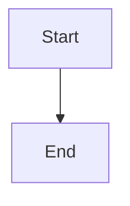

# Browse pinned branch architecture from the War Room

## Parent Epic

epic_046

## Scope

# Browse pinned branch architecture from the War Room

## Intent
A user can explore the current War Room branch's versioned architecture independently of proposal review, with accurate code/documentation provenance.

## Scope
Own epic_046 requirement 5. Add an accessible top-level Architecture tab while retaining operational panels and selected-tab navigation state. Reuse the production render/artifact contracts and viewer primitives delivered by preceding features.
Default to the session's target checkout/worktree, with explicit selection among known project contexts. Pin each browsing session to its commit and show repository, branch and full revision details; detached HEAD is accurate and dirty edits never masquerade as committed architecture.
Resolve versioned models through configured target/tracking destination and stable mappings. In split repositories use recorded branch/review/lineage documentation associations. When absent, offer known documentation-ref selection or explicit unavailability, never an implicit tracking-HEAD fallback. Distinguish branch content from an explicitly labeled accepted-lineage reference.
Provide view switching, target and relationship details, drill choices/back, pan/zoom/fit and sensible initial views. Use bounded shared background rendering and caching; opening the tab must not stall the board or rerender on each board refresh.
A changed branch HEAD produces an update indicator and explicit snapshot refresh. Deep links include repository context, pinned ref, view/level and selected semantic target and restore on reload; invalid links explain failure.
Browsing neither creates a review unit nor approves work. Link to plan review only for a specific associated proposal. Expose the selection/context seam used by feat_046_004.

## Acceptance
- Real browser verifies default session context, navigation, second known branch with differing model, detached HEAD, dirty worktree behavior, missing model/deeper view and readable source.
- Advancing HEAD does not mix revisions; explicit refresh switches the whole snapshot.
- Deep-link reload restores pinned selection.
- Split code/documentation repositories show both refs; missing association is explicit.
- Tab remains responsive during pending/failed rendering and repeated board refresh reuses cached work.
- Extend shared acceptance fixture rather than substituting fabricated diagram payloads.

## Boundaries
No dirty preview, arbitrary filesystem browsing, new branch comment store or additional renderer/viewer implementation.

## Data structures

TBD.

## API contracts

TBD.

## Logic flow

## Task breakdown

1. **task_046_003_001 — Known contexts and documentation provenance.** Resolve the session target and selectable known worktrees, pinned commits, configured model destination, and exact split-repository associations; expose explicit documentation-ref selection when association is absent.
2. **task_046_003_002 — Durable browsing snapshots.** Pin code/document commits, mapping, closure and render identity; reuse bounded shared rendering and caching; recover immutable snapshots after restart. Depends on 001.
3. **task_046_003_003 — Scoped snapshot HTTP contract.** Expose contexts, snapshot creation/read, HEAD-change status and authorized artifact/resource URLs with bounded, explicit lifecycle states. Depends on 002.
4. **task_046_003_004 — Architecture tab.** Reuse the semantic viewer for navigation and details; preserve tab state and deep links; show provenance, pending/failure states and explicit whole-snapshot refresh. Depends on 003.
5. **task_046_003_005 — Real browser acceptance.** Extend the shared real renderer/Chromium fixture across branch selection, pinning, provenance, update, deep links and failures. Depends on 004.

## Risks & upward questions

None.

## Decision log

None yet.

## Closeout

Completed child work: `task_046_003_001` (Resolve known branch contexts and exact documentation refs), `task_046_003_002` (Create durable revision-pinned browsing snapshots), `task_046_003_003` (Expose scoped snapshot and artifact HTTP routes), `task_046_003_004` (Build the Architecture tab and pinned navigation), `task_046_003_005` (Prove branch browsing with real renderer and Chromium).
