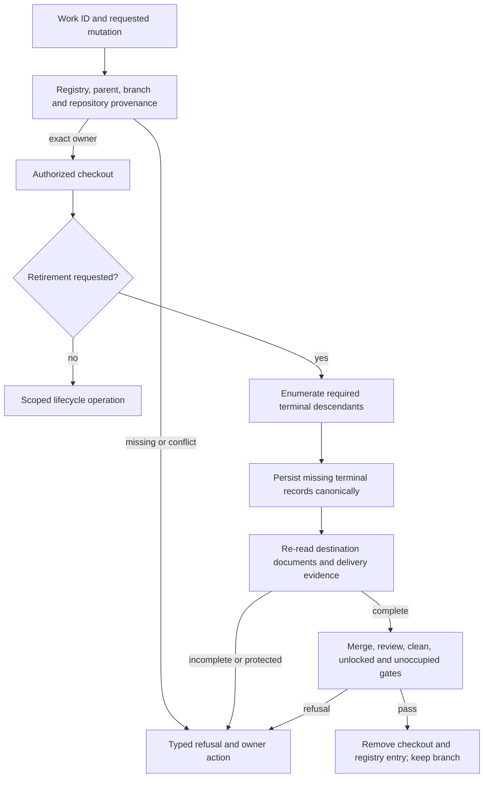

# Resolve exact work owners and preserve descendants before retirement

## Parent Epic

[epic_047](../../epics/2_active/epic_047_recover_late_repair_delivery_after_feature_completion.md). This feature owns success criteria 8–9 and the descendant persistence portion of 15. Preserve existing approval, review, branch, delivery and execution evidence; do not broaden into the late-repair transition or publication workflow owned by sibling features.

## Scope

Resolve the canonical owner before any lifecycle mutation and prove terminal descendants remain discoverable before removing a parent worktree. Read projections may retain historical copies; mutation authority must come from exact work identity, parent, registered checkout, branch and product/tracking provenance. Refuse missing or conflicting ownership with a typed next action. Persist missing terminal descendants canonically, re-read them, then allow only already safe retirement. Keep legacy ambiguous records recoverable without guessing.

Out of scope: a new registry or ledger, broad merged-board ranking changes, late-repair reactivation, review publication redesign, dependency installation and product trunk mutation.

## Data structures

The existing integration-worktree registry remains the source of checkout identity; WorkMeta and board columns remain the document/lifecycle schema. The owner result is a validated checkout/root plus its work ID, tier, parent and registered branch provenance, or a typed refusal with a reason and recovery action. Its exact Python representation can follow current Workspace conventions. The retirement proof is derived from the parent and required descendant documents, canonical destination, existing execution/delivery evidence, branch/merge evidence and review obligations; it is not a second persistent ledger. A completed parent document alone is insufficient.

## API contracts

- Workspace exposes one reusable mutation-owner resolver for a given work ID and repository context. It verifies exact registered owner and canonical branch/root identity; missing, changed or conflicting evidence fails closed. `merged_board`, `_meta_preference` and `resolve_doc_worktree` remain read-oriented and cannot by themselves grant mutation authority.
- Workspace exposes a descendant-aware retirement precondition used by `retire_integration_worktree`, `retire_terminal_registered_worktrees` and Boss `_retire_feature_worktree`. It identifies required terminal descendants, persists absent terminal records through canonical board operations, re-reads destination evidence, and refuses removal if any required record/provenance or protected gate remains unresolved.
- Existing lifecycle locking, branch ancestry/forge confirmation, clean/locked/occupied checks, review obligations and execution/delivery ledgers remain authoritative. The Boss caller must retain branch, registry and checkout on refusal. Split product/tracking roots use their configured destinations and never select a sibling's historical copy.

## Logic flow

On restart, the supervisor reconstructs the board from surviving registered roots and repeats the proof. A stale active Task checkout cannot supersede a canonically persisted completed Task. Interrupted persistence keeps the source checkout until readback succeeds; repeated reconciliation is idempotent.

## Task breakdown

- `task_047_001_001` — exact mutation-owner resolution; no dependency.
- `task_047_001_002` — descendant persistence and retirement gate; depends on `task_047_001_001`.
- `task_047_001_003` — production-path convergence regression and final architecture reconciliation; depends on `task_047_001_002`.

## Design and diagram impact

`cascade/workspace/DESIGN.md` owns REQ-WORKSPACE-OWNER-001 and REQ-WORKSPACE-RETIRE-001. `cascade/board/DESIGN.md` and `cascade/boss/DESIGN.md` retain REQ-BOARD-001 and REQ-BOSS-001 ownership and describe only their changed interfaces. `cascade/DESIGN.md` summarizes the boundary. The implementers review these designs against the final diff and keep source-linked structure, normal/refusal/restart flow, persistence and evidence current.

| Level / view | Required reconciliation |
|---|---|
| Landscape `cascade-landscape`, context `cascade-context` | Verify no person or external responsibility changes; these operations stay in Cascade. |
| Containers `cascade-containers` | Verify supervisor/repository communication and persistence remain local; no new runtime/data container. |
| Components `cascade-supervisor-components` | Reconcile Workspace and Boss retirement/owner interfaces and relationships with actual code. |
| Code `cascade-workspace-code`, `cascade-boss-code` | Reconcile `resolve_doc_worktree`, `merged_board`, `_meta_preference`, `get_integration_worktree`, `terminal_doc_persisted_outside_worktree`, `retire_integration_worktree`, `_retire_feature_worktree` and any new owner/proof symbols. Keep `model.dsl`, `views.dsl` and `workspace.contract.json` synchronized. |
| Behavior | Trace exact-owner normal/refusal, descendant persistence, protected refusal and restart/replay in the owning designs. |

Validate source contract and supported local rendering. Verify Context → Containers → Supervisor Components → Code, Level up, deep-link restoration and opening representative pinned source. Record actual checks, unaffected-level reasons and unresolved gaps in Task closeout. Design edits are proposals until reviewed against implementation and the revision-pinned architecture publication path.

## Risks & upward questions

The first Task dispatched immediately at mint and therefore retained its detailed mint-time implementation notes; any contract gap discovered during execution returns through normal Task failure/revision. No Epic amendment is currently required. Preserve ambiguous legacy state as a refusal rather than inventing completion. Parent review acceptance cannot be inferred from Task delivery.

## Decision log

Decision entries are appended through `record_decision`.

- `dec_001` · 2026-11-24 · Feature Lead · **API contracts**
  Chose Use exact registered work identity, parent, branch and repository provenance to authorize mutation; merged-board preference remains a read projection..
  Rationale: A completed historical copy in a sibling checkout can outrank the owner's backlog copy, so rank cannot prove writable ownership. Missing or conflicting identity must refuse with an owner action.
  Honors: epic_047 success criterion 8; REQ-WORKSPACE-OWNER-001; REQ-BOARD-001.

- `dec_002` · 2026-11-24 · Feature Lead · **API contracts**
  Chose Gate parent worktree retirement on canonical readback of every required terminal descendant and its delivery/completion provenance, then apply existing merge, review and checkout safety gates..
  Rationale: A surviving parent document alone can leave the final completed Task visible only in a removed checkout; repeated reconciliation must not resurrect a stale active copy.
  Honors: epic_047 success criteria 9 and 15; REQ-WORKSPACE-RETIRE-001; REQ-BOSS-001.

## Closeout

Completed child work: `task_047_001_001` (Resolve exact work owner for lifecycle mutation), `task_047_001_002` (Preserve descendant terminal evidence before worktree retirement), `task_047_001_003` (Verify owner and retirement convergence across lifecycle surfaces).
