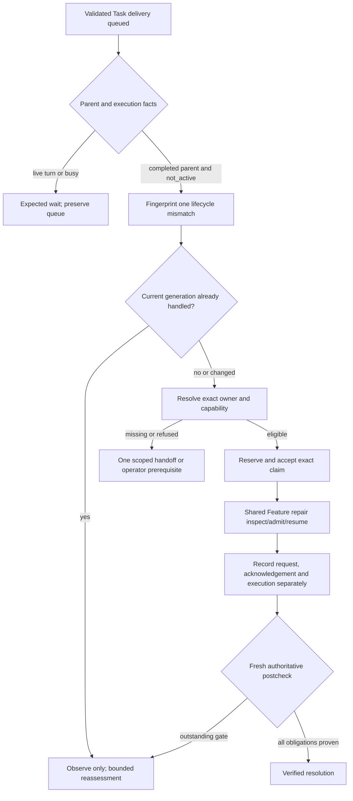

# Execute lifecycle mismatch recovery through parent and audit supervision

## Parent Epic

[epic_047](../../epics/2_active/epic_047_recover_late_repair_delivery_after_feature_completion.md). This feature owns success criteria 5–6 and 12. It uses the exact owner resolution and descendant survival boundary from feat_047_001 and the generation-bound repair action, authority event, validation and review obligations from feat_047_002. Human approvals, direct-child scope, execution leases, review gates and immutable action history remain binding.

## Scope

Deliver one executable, generation-bound route for a validated Task whose completed Feature parent refuses merge with `not_active`. Feature self-recovery, immediate Epic supervision and admitted audit recovery must converge on the same Feature repair action. Keep one typed incident and a bounded read-only projection through request, acknowledgement, execution and authoritative postcheck.

In scope: `cascade/task_rollup.py`, Task action and supervisor recovery, Feature/Epic adapters, watchdog audit observation/admission/investigation, shared incident records and minimal Board/War Room consumers. Out of scope: a second scheduler or store, automatic ancestor reopening, audit dashboard redesign, a new external service, software installation, and the broad end-to-end/runtime handoff owned by feat_047_004.

## Data structures

- `ParentLifecycleMismatch` is an additive typed incident envelope in the existing action/incident stores. It binds Task ID, Feature/Epic IDs, original queued delivery action and validation pair, blocked operation/reason, exact mutation owner/fingerprint, authoritative generation, repair action/generation/phase, prior and required review identity and source/target heads, prerequisite evidence, freshness/reassessment deadline, and verified outcome. Legacy unknown fields remain explicitly unknown; old attempts are retained.
- The generation fingerprint includes the exact owner and parent status, delivery/repair identity, relevant source and target heads, current review obligation, approval/comment/dependency gates, execution lease identity and repair result. Observation alone does not create a new repair obligation. A changed relevant fact permits a fresh assessment; an identical observation preserves the existing identity and bounded cooldown.
- A recovery result distinguishes `selected_operation`, `accountable_owner`, `admitted_or_requested`, `acknowledged`, `executed`, `verified`, `refusal` and `next_prerequisite`. A queue message or started turn sets no verified flag. The existing action ledger and incident reservations remain the durable authority; projections are read-only.

## API contracts

- Task merge routing classifies `not_active` with a completed Feature parent as `parent_lifecycle_mismatch` and links it to the current Feature repair request. `busy` and a live Feature/Task turn remain `expected_wait`. The first refusal stays in attempt history; later identical sweeps perform no merge and spend no further merge attempt, worker turn, message or publication. Active-parent `not_active` is separately diagnosed from current evidence.
- A shared scoped adapter accepts Task or direct Feature identity plus expected authoritative generation, resolves the registered mutation owner, checks direct parentage and current gates, and invokes the existing `feature_repair` inspect/admit/resume operation. Feature `recover_task`/`supervise_child`, Epic `recover_feature`/`supervise_child`, and the audit capability descriptor call this adapter, not independent lifecycle transitions. Admission rechecks inside the lifecycle lock; external observation and provider/forge work occur outside it. Stale generation, changed owner/head, live owner, dirty or missing checkout, comment/approval/dependency and review refusals return typed evidence without fabricating authority.
- The audit registry selects a named owner/tier/failure-specific capability for `parent_lifecycle_mismatch`. Its existing reservation and claim token fence one execution across simultaneous callers. A missing or broken capability creates one generation-keyed scoped handoff through current incident/investigation machinery when an eligible owner exists; otherwise return an exact operator prerequisite. Finite reassessment may retry a proven changed condition or expired capability check; it never replays the impossible merge.
- An authoritative postcheck reads canonical board, exact owner/registry, execution/delivery action, current review generation and accepted source/target heads, integration evidence and descendant survival/retirement facts. It marks the associated incident verified only when the owed delivery, publication, integration and persistence obligations are satisfied. A local Feature status change, acknowledgement or old accepted review is insufficient. Restart/replay performs the same check and retains unresolved history.

## Logic flow

The action ledger survives restarts. Replay rechecks owner, generation and claim identity before execution. A live lease remains owned by its process; an interrupted claim is reconciled by its existing token. Unknown legacy review or ownership facts fail closed with a typed prerequisite.

## Task breakdown

| Task | Purpose and acceptance | Depends on |
|---|---|---|
| `task_047_003_001` | Classify completed-parent `not_active` once per authoritative generation, preserve delivery/validation/history, keep busy/live turns as waits, and connect Feature self-recovery to the canonical Feature repair action. Focused tests must assert unchanged sweeps spend no merge attempts, wakeups or messages; stale owner/generation and gate refusals fail closed. Update Task/Feature/package design and significant Code nodes. | None |
| `task_047_003_002` | Execute the same scoped action through immediate Epic and admitted audit adapters with exact claim, durable request/acknowledgement/result, bounded missing-capability handoff and no duplicate side effects. Update Watchdog/Epic/package design and native Code view/source contract. | `task_047_003_001` |
| `task_047_003_003` | Prove fresh delivery/review/integration/retirement postchecks, one typed incident across Task/parent/audit projections, bounded read-only consumers, restart/replay and final design/C4 reconciliation. | `task_047_003_002` |

Task 1 was dispatched by the watchdog immediately after minting. Its Task document contains the detailed implementation instructions but the generated acceptance/test headings remain placeholders because the board refuses revision while active. The Task 1 acceptance in this owning Feature contract is therefore explicit above; completion review must compare its delivered diff and evidence against it. Tasks 2 and 3 have complete Task acceptance and test plans persisted before dispatch.

## Design and diagram impact

The authoritative source is [workspace.dsl](../../../architecture/target-9f61bc6d6f8ae8cb7d196c8b327650d5/workspace.dsl), [model.dsl](../../../architecture/target-9f61bc6d6f8ae8cb7d196c8b327650d5/model.dsl), [views.dsl](../../../architecture/target-9f61bc6d6f8ae8cb7d196c8b327650d5/views.dsl) and the synchronized source contract. Existing design anchors: [REQ-CASCADE-RECOVERY-001](../../../cascade/DESIGN.md#delivery-and-review-boundaries), [REQ-WATCHDOG-REPAIR-001](../../../cascade/watchdog/DESIGN.md#recovery-admission-and-active-path-authority), and the Feature repair/Task delivery owners. Do not duplicate these requirements in consumer designs.

| Level / view | Current boundary and planned reconciliation | Task owner and verification |
|---|---|---|
| `cascade-landscape`, `cascade-context` | Existing operator, supervisor, forge and provider relationships cover this repair; no actor or external dependency changes. | Task 3 checks unchanged topology against final diff. |
| `cascade-containers` | Existing local supervisor and repository stores retain actions, queues, reviews and claims; no deployment boundary changes. | Task 3 checks persistence/restart wording and avoids OS-isolation claims. |
| `cascade-supervisor-components`, `cascade-team-components` | Watchdog routes to Feature repair through scoped Epic/Feature adapters; Boss and Workspace retain merge/owner authority. | Tasks 1–2 reconcile affected edges; Task 3 checks component navigation. |
| `cascade-watchdog-code` (`element.component.watchdog`) | Show real mismatch observation, capability/claim, executor and postcheck symbols in native custom Code view. | Tasks 2–3 update model and contract together; validate source symbols. |
| `cascade-epic-code`, `cascade-feature-code`, `cascade-task-code` | Show callable immediate-parent, Feature, and Task routing adapters if new significant symbols are added. `cascade-teams-code` remains unchanged if role graph/provider topology is unchanged. | Tasks 1–3 reconcile owning designs and Code views against actual diff. |
| Supplementary flow | Normal route, changed/stale generation, missing capability, live wait and restart/resume. | Task 3 updates Watchdog, package, Epic, Task, Feature and War Room design implications with links and inspectable evidence. |

Task 3 validates the model/source contract, supported local render, checkout-relative links, C4 Explore into Code, Level up, deep-link restoration and representative pinned source opening. It records cold/warm render observations without a universal latency claim. Keep accepted snapshots immutable and follow the revision-pinned publication workflow.

## Risks & upward questions

The shared adapter must preserve the exact owner and approval boundaries when called from an audit worker or an Epic team. The operator prerequisite is explicit if no legal capability can run. Unknown legacy facts are a refusal, never invented acceptance. No Epic amendment is currently required; any necessary contract change is proposed upward before implementation.

## Planning closeout and verification

Reviewed `cascade/DESIGN.md`, `cascade/{watchdog,feature,epic,task,war_room}/DESIGN.md`, the current C4 model/contract, and source entry points in Task rollup, Feature repair, team supervision, Epic recovery and audit admission. Existing designs correctly describe current authority and source-linked execution; they still identify team wakeup and transient `not_active` routing as gaps. The task acceptance below assigns their repair and final design reconciliation. No design file changed in this planning turn. The context/container topology is unchanged for the concrete reason in the inventory. Final tests, renderer navigation and postcheck results remain Task evidence, not planning claims.

## Decision log

None yet.

- `dec_001` · 2026-11-24 · Feature Lead · **API contracts**
  Chose Classify completed-parent not_active as parent_lifecycle_mismatch and suppress identical merge retries while retaining the original attempt and validation pair..
  Rationale: The parent lifecycle prerequisite cannot change through another merge attempt; a generation-bound owner operation can change it, while busy/live turns remain waits.
  Honors: epic_047 success criteria 5–6; REQ-CASCADE-RECOVERY-001; REQ-WATCHDOG-REPAIR-001.

- `dec_002` · 2026-11-24 · Feature Lead · **API contracts**
  Chose Route Feature, immediate Epic and admitted audit requests through one scoped Feature repair adapter with existing reservation and claim authority..
  Rationale: One durable action and exact owner/generation check prevents separate callers from reopening the parent or claiming a queue wakeup as recovery.
  Honors: epic_047 success criteria 5 and 12; feat_047_002 repair action contract.

- `dec_003` · 2026-11-24 · Feature Lead · **Data structures**
  Chose Use one additive typed incident with distinct requested, acknowledged, executed and verified evidence; clear it only after authoritative delivery, review, integration and persistence postchecks..
  Rationale: A successful adapter invocation or old accepted review does not prove the repair obligation; the existing incident/action stores can preserve history and support bounded read projections.
  Honors: epic_047 success criteria 5 and 12; REQ-WATCHDOG-REPAIR-001.

## Closeout

Completed child work: `task_047_003_001` (Route completed-parent Task delivery through Feature repair), `task_047_003_002` (Execute scoped Epic and audit recovery with durable handoff), `task_047_003_003` (Verify recovery obligations and project one typed incident).
