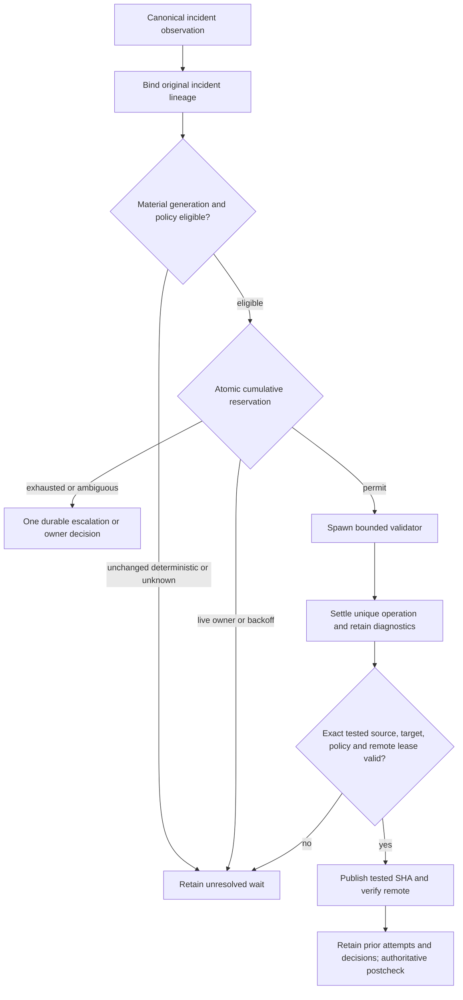

# Enforce durable incident budgets at recovery admission

## Parent Epic

epic_048

## Scope

## Outcome
A recovery incident retains one finite allowance across action IDs, generations, restarts and escalations. Unchanged deterministic failure cannot start a second expensive check. Material change permits reconsideration only against remaining cumulative allowance or an independently authorized extension.

## Scope and ownership
Own the incident identity, lineage, reservation, consumption and extension contracts in the existing recovery stores and lifecycle locks: cascade/watchdog/incidents.py, reservations.py, cascade/task/action_recovery.py, and the team review/review-validation admission boundary. Reuse current exact-SHA publication and process cleanup. Do not introduce another scheduler/database. Coordinate provider consumers through a documented interface for F2; paid-work enforcement is completed there.

## Acceptance criteria
- Epic success criteria 3–7 and 16–19: persist original incident identity separately from material generation; linked actions/children cannot self-assign a fresh budget. Retain legacy decisions and attempts. Ambiguous legacy lineage or consumption waits for an explicit owner decision; known exhausted history needs a bounded extension.
- Atomically reserve allowance before an expensive process; reconcile once by operation identity, retaining uncertain in-flight consumption after crashes. Concurrent owners cannot overspend or reclaim a live owner. Track attempts, validator/process time and elapsed time separately; preserve original start time and usage across policy cycles, provider switches and cosmetic revisions.
- Replace automatic attempt-bound growth in admit_review_publication_generation with both generation admission and cumulative-budget admission. Same deterministic failure runs once; transient default is at most three total attempts with bounded exponential backoff/jitter. Unknown failure classification fails conservatively.
- Implement the epic's proposed bounded defaults/maxima under trusted repository/operator policy. Budget policy version is part of admission. Extension uses authenticated independent authority, reason, added bounded allowance and retained prior consumption; a retrying agent cannot self-grant it. Exhaustion creates one durable escalation and leaves delivery unresolved.
- Retain the production publication regression and add a narrow real-process/bare-remote journey proving timeout once, restart suppression, authorized policy correction/extension, exactly one useful next publication, old resolved decision retention and independent remote verification. Assert real spawn/push counts, not only statuses.
- Unit boundaries only where integration evidence does not cover them. No broad refactor of unrelated action kinds.

## Designs and diagrams
Own REQ-RECOVERY-BUDGET-001 and DEC-RECOVERY-BUDGET-001 in cascade/task/DESIGN.md (new proposed IDs); use existing REQ-WATCHDOG-REPAIR-001 and REQ-REVIEW-PUBLISH-001 as linked authority contracts. Update cascade/DESIGN.md and cascade/watchdog/DESIGN.md at the interfaces. Affected views: cascade-supervisor-components, cascade-task-code, cascade-watchdog-code, and the existing team/publication component's integrated Code coverage. Define exact reservation/usage/extension entry points in the feature plan before tasking.

## Required Task acceptance contract

Feature planners must copy the applicable epic diagram-impact rows into Task acceptance criteria and budget that work with the implementation. Preserve existing requirement owners; proposed new IDs become current design facts only after implementation is reconciled. Update owning DESIGN.md, model.dsl, views.dsl and workspace.contract.json together when structure changes. Native custom Code views must link real source symbols and declaration kinds, support context → container → component → Code, Level up, deep links and pinned source. Include normal and failure/restart flows, persistence, authority and process isolation limits. Verify source contracts, supported local rendering and representative browser navigation; record actual evidence and gaps in work records. Do not rewrite accepted architecture snapshots.

Use production tool adapters, durable stores and real temporary repositories/processes for integration proof. Scripted external provider/forge transport is permitted; fake successful repair, validation, publication or final verification is not. No raw success setters or lifecycle-file edits to force progress. Tests must count effects independently. Keep product acceptance separate from review validation. Preserve Codex and the parent's explicit role/model/reasoning assignments. No dependency installation or live deployment is authorized by this feature.

## Data structures

Proposed versioned `incident_budgets` map in tracking-root `.cascade/executions.json`, written under `task_lifecycle_lock` and its existing atomic file replacement. Its key is the original authoritative incident identity, distinct from each material generation, action and child ID. A record retains original admission time, lineage links, trusted policy ID/version and limits, charged and reserved totals by dimension (process attempts, process seconds, paid turns, model seconds, known tokens and elapsed deadline), unique operation/claim receipts, append-only extension receipts and one escalation identity. Each operation stores its kind, reserved worst-case allowance, claim/owner identity, start/deadline, observed usage quality (`known`, `estimated` or `unavailable`) and final state. Cached tokens are a subset of input tokens. In-flight/unknown consumption stays charged conservatively until authoritative reconciliation. Old attempts and decisions remain in their current action records.

Default/maximum policy, copied from the parent: one failed expensive check for unchanged deterministic material evidence; three total transient attempts for one operation with persisted 5 s then 10 s backoff and ±20% bounded jitter; incident-wide tool attempts 6/20, paid turns 6/12, process runtime 1,800/7,200 s, model runtime 1,800/7,200 s, elapsed time from original admission 3,600/86,400 s, and known input-plus-output tokens 200,000/1,000,000. A single validator normally retains its approved 300 s timeout, capped at 3,600 s and by the remaining reservation; a model turn is 300/900 s. One top-level claim is live per incident; nested work shares that claim but receives a separate operation receipt and charge. Trusted repository/operator policy records a version and cannot silently weaken a required validation profile. Unknown provider usage is reported as unavailable and falls back to turn/runtime limits; hard token enforcement requires provider evidence.

Legacy action history with a provable original incident and known use is folded into that record without erasure. Ambiguous lineage, missing usage or corrupt/unreadable accounting pauses admission for an owner decision. Known exhaustion requires a bounded independent extension. A replacement action or child must cite its original incident; its own ID cannot mint allowance.

## API contracts

Task-owned proposed entry points in `cascade/task/incident_budget.py`, using `action_recovery.py` ledger I/O and `lifecycle_lock.py`:
- `bind_incident_budget(incident_id, action_id, generation, evidence, *, root)` verifies the canonical incident/action lineage and binds it idempotently. It rejects a caller-supplied new identity with no authoritative parent.
- `reserve_incident_operation(incident_id, operation_id, kind, worst_case, claim_id, policy_version, *, root)` atomically checks lineage, live claim, trusted policy/version, generation eligibility, backoff, elapsed deadline and every remaining cumulative dimension. It returns a typed admitted/pending/exhausted/owner-decision result with a bounded execution permit; replaying an operation ID never grants a second permit.
- `settle_incident_operation(incident_id, operation_id, observation, *, root)` charges the observed attempt/runtime/usage exactly once, keeps unknown or interrupted allocation conservative, and persists next eligibility or exhaustion. A proven dead owner may be reconciled; lease age alone cannot reclaim a live owner.
- `extend_incident_budget(incident_id, authenticated_authority, reason, evidence, finite_additions, *, root)` verifies an independent operator/repository authority against the recovering team and policy maxima, appends the extension and preserves all prior usage. Actor text alone is not authorization.
- `read_incident_budget(incident_id, *, root)` is a bounded read for Watchdog and future F2 provider consumers. It exposes policy, consumption quality, wait reason and escalation ID without spending.

`watchdog/incidents.py` preserves original identity separately from `authoritative_generation`; `watchdog/reservations.py` remains the observation/capability claimant and calls the Task budget gate before an expensive owner operation. The team review adapter passes the canonical incident/claim/operation identity into `check_and_publish_review_rebase`; the validator reserves before spawn and settles on every success, failure, timeout and interruption. `admit_review_publication_generation` only admits material change; it cannot grow `attempt_bound` or bypass the cumulative gate. Review generation includes exact source/target heads, approved validation profile/version and relevant environment revision, excluding clocks and cosmetic reports. Green evidence stays tied to tested SHA and current remote lease. F2 consumes these APIs for paid provider turns; F1 does not claim provider enforcement.

## Logic flow

## Diagram-impact inventory

| Level and view | Owner and source | Required reconciliation and evidence |
|---|---|---|
| Landscape `cascade-landscape`, `cascade-context` | Root `DESIGN.md`; existing operator, provider, forge and Cascade boundaries | Independent extension authority stays with the existing operator boundary. Verify context navigation; change the view only if implementation adds a relationship. |
| Containers `cascade-containers` | Root and `cascade/DESIGN.md`; worker and tracking-root sidecar | No new service or database. Show the existing durable ledger boundary and avoid implying OS isolation. Verify persistence/restart from source. |
| Components `cascade-supervisor-components`, `cascade-team-components` | `cascade/DESIGN.md`; Task budget, Watchdog observation and team review publication | Show admission → reservation → validator → exact-SHA publication → postcheck and failure/escalation edges. Reconcile interfaces with child designs. |
| Code `cascade-task-code` | `cascade/task/DESIGN.md`; `action_recovery.py`, new budget entry points and lifecycle lock | Add real Function declarations and relationships for lineage, reserve, settle, extend and generation admission. Link source symbols and owning component; verify Code Explore, Level up and deep link. |
| Code `cascade-watchdog-code` | `cascade/watchdog/DESIGN.md`; `incidents.py`, `reservations.py` | Show original identity binding and the Watchdog consumer of the Task gate without a second budget owner. Verify source symbols, kind and failure path. |
| Code `cascade-teams-code` | `cascade/DESIGN.md`; `team_review_recovery.py`, `review_rebase.py`, `review_validation.py` | Show permit carried to real validator spawn and settlement, preserving tested-SHA/lease checks. Verify browser navigation and pinned source. |
| Behavior | Task, Watchdog and package designs | Document normal, timeout, crash/restart, exhaustion and authorized extension paths; state persistent fields, owner authority and local process-group versus provider limits. |

Change `model.dsl`, `views.dsl` and `workspace.contract.json` together when new declarations or relationships are implemented. Keep semantic IDs stable, use native `cascade.codeComponent` views and real `cascade.parent`, `cascade.sourcePath`, `cascade.sourceSymbol` and declaration kind metadata. Do not rewrite accepted snapshots. Design review at planning: `DESIGN.md`, `cascade/DESIGN.md`, `cascade/task/DESIGN.md`, `cascade/watchdog/DESIGN.md` and the pinned model/views/contract were read against current source. No design is edited before implementation because the new functions and behavior do not yet exist; each task below must reconcile its actual diff and record verification/gaps.

## Task breakdown

1. `task_048_001_001` — establish original-incident lineage, trusted versioned policy, conservative legacy migration, independent bounded extension and one durable exhaustion escalation. Verify lineage, authority and restart; reconcile Task/Watchdog designs and Code views.
2. `task_048_001_002` — after Task 1, add atomic reserve/settle and the Watchdog consumer under the existing cross-process lock. Prove unique settlement, concurrent exclusion, live-owner protection, uncertain charging and elapsed-time preservation; reconcile Task/Watchdog Code views.
3. `task_048_001_003` — after Task 2, gate real review-publication checks, preserve exact-SHA publication, and run the bare-remote restart/timeout/extension journey with independent spawn/push counts. Reconcile supervisor/team Code views and all owning designs; verify source contract, render and browser navigation.

## Risks & upward questions

The legacy ledger may lack provable original lineage or usage; admission must wait for an explicit owner decision rather than manufacture a fresh allowance. A configured validator longer than remaining budget requires its policy owner, without reducing coverage. Process group cleanup bounds local children; remote provider usage and paid-turn admission remain F2-owned.

## Decision log

- `dec_001` · 2026-11-24 · Feature Lead · **Incident budget ownership**
  Chose Store one versioned cumulative budget per original incident in the existing tracking-root executions.json ledger under the cross-process Task lifecycle lock; link actions and generations to that budget..
  Rationale: The current action ledger already persists recovery attempts and has atomic replacement and a shared lifecycle lock. A separate budget store or generation-local counter would permit divergent allowance after restarts or replacement actions.
  Honors: Feature acceptance on lineage, cumulative consumption, restart and concurrency; epic success criteria 16–19; DEC-RECOVERY-BUDGET-001 proposed in the owning Task design..

- `dec_002` · 2026-11-24 · Feature Lead · **Conservative admission and extension**
  Chose Fail closed on ambiguous legacy lineage or usage, keep unknown in-flight allocation charged, and accept only independently authenticated finite extensions within trusted policy maxima while preserving prior consumption..
  Rationale: Unknown accounting cannot justify another paid check. An action owner granting its own allowance would defeat the cumulative limit; durable extension receipts provide an auditable path for material correction.
  Honors: Feature acceptance on legacy migration, exact settlement and independent authority; epic success criteria 4 and 16–19..

## Closeout

Completed child work: `task_048_001_001` (Persist original incident lineage and bounded policy), `task_048_001_002` (Reserve and settle incident operations atomically), `task_048_001_003` (Gate review publication and prove bounded recovery).
