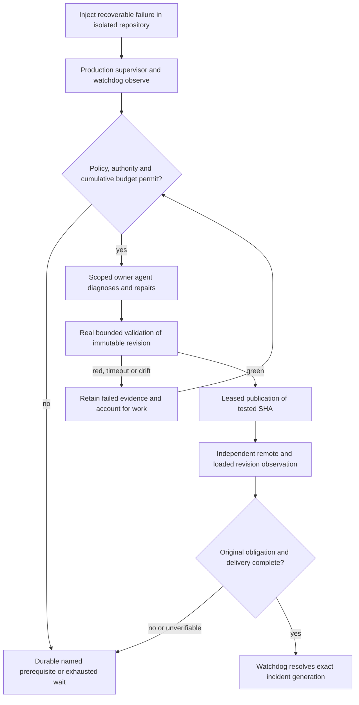

# Gate recovery with adversarial CI and controlled supervisor evidence

## Parent Epic

epic_048

## Scope

## Outcome
The completed recovery contract runs automatically and fails when a key safeguard is deliberately broken. Completion includes a controlled real supervisor recovery through supported entry points, with honest unresolved prerequisites.

## Scope and ownership
Own the shared recovery harness matrix, .github/workflows/recovery-contract.yml, bounded failure artifact capture, local setup/run documentation and the final evidence dossier. Extend prior features' high-signal integration scenarios instead of duplicating their tests.

## Acceptance criteria
- Epic criteria 9–19: retain existing review-recovery checks and run the actual owner-agent journey on relevant PRs and main. Named check remains Recovery contract; bounded CI job initially 10 minutes, failing on timeout, with sanitized evidence retained on failure. No optional/manual-only gate or silent prerequisite skips in the acceptance job.
- Cover actual red tests, insufficient budget, malformed policy, policy/head drift, stale admissions, remote competition, dirty/uncommitted changes, live owners, wrong scope, missing capability, denied approvals/credentials, unavailable evidence; crash before claim/during checks/after commit/after push/before receipt; normal and split roots.
- Independently count process/model/worker/Task/review/message/publication effects. Prove one unchanged expensive failure, transient cap, paid-turn cap, concurrent reservations, unknown usage and bounded overrun/cancellation. Restart/generation/cosmetic commit/provider switch/policy cycle/replacement action cannot reset allowance. Repeated audit requests remain coalesced after exhaustion. Test denied and authorized bounded extensions with prior history intact.
- Controlled fault mutations separately breaking deduplication, validation, immutable publication, independent postcheck and receipt recovery each fail the relevant test. Revert faults; never weaken checked-in production checks.
- Publish exact local commands, fresh-workspace prerequisites, revisions, profile/budget/actor/decision/claim IDs, restart points, retained diagnostics and independent remote/deployment observations.
- Execute a controlled real supervisor incident through approved UI/agent routes with normal review and installation boundaries. Record actual observed model usage or unavailable status, exact deployed revision, fresh verification and remaining acceptance obligations. If authority/environment is unavailable, preserve a named blocking prerequisite and do not recommend epic completion.
- Verify the final diagram inventory against implemented diff: supported source validation/rendering, UI context → container → component → Code, Level up, deep-link restoration and pinned-source opening; normal/failure isolation traces, stale renamed/deleted symbols and moved owners, warm artifact reuse and measured performance without per-view process launches.
- Acceptance requires both deterministic CI and supported operational evidence; passing this feature's tests alone cannot close the epic.
- Final deterministic acceptance requires the exact F1 correction on PR #251, its successful review-recovery check, supported integration into this Feature, and the full 10-minute-bounded selection with the original material-generation retry regression. Preserve the missing F1 owning reconciliation receipt as an explicit final closeout gap and refresh the dossier and architecture review at the exact integrated SHA.

## Designs and diagrams
Reconcile all affected design owners from F1–F3 against final source. README owns setup/run instructions; work records own execution evidence and chronology. No new C4 container for the harness: it uses production boundaries and temporary test artifacts covered by the root design. Only actual runtime/interface deltas justify model edits.

## Required Task acceptance contract

Feature planners must copy the applicable epic diagram-impact rows into Task acceptance criteria and budget that work with the implementation. Preserve existing requirement owners; proposed new IDs become current design facts only after implementation is reconciled. Update owning DESIGN.md, model.dsl, views.dsl and workspace.contract.json together when structure changes. Native custom Code views must link real source symbols and declaration kinds, support context → container → component → Code, Level up, deep links and pinned source. Include normal and failure/restart flows, persistence, authority and process isolation limits. Verify source contracts, supported local rendering and representative browser navigation; record actual evidence and gaps in work records. Do not rewrite accepted architecture snapshots.

Use production tool adapters, durable stores and real temporary repositories/processes for integration proof. Scripted external provider/forge transport is permitted; fake successful repair, validation, publication or final verification is not. No raw success setters or lifecycle-file edits to force progress. Tests must count effects independently. Keep product acceptance separate from review validation. Preserve Codex and the parent's explicit role/model/reasoning assignments. No dependency installation or live deployment is authorized by this feature.

## Data structures

Reuse the versioned incident budget and action records in tracking-root `.cascade/executions.json`, role invocation receipts, review generations, pending delivery, queue/checkpoint records and loaded-runtime receipt. The harness owns only temporary fixture repositories, effect counters and sanitized CI evidence; it must not create another recovery authority or durable product schema. Each scenario identifies the original incident, action/material generation, claim and reservation, actor/capability, source/target/policy/loaded revisions, physical invocation and postcheck result. Retain separate observed, estimated and unavailable usage.

## API contracts

The acceptance harness calls production paths, using the existing real-repository fixtures in `tests/test_late_repair_convergence.py` and `tests/test_review_recovery_journey.py` as the starting point. The scoped route is `watchdog.audit_recovery.dispatch_audit_recovery(root, work_id, ...)` → capability resolution and `watchdog.reservations.reserve_after_recheck` → `feature.recovery.recover_task` / `feature.repair.feature_repair` or the tier-owned publication action. Task work goes through `task.git_tools.swe_run_tests` and `swe_commit`, then `boss.merge.merge_task_branch`. Review publication uses `team_review_recovery.publish_team_review_resolution(action_id, team_kind, team_id, root)`, `review_validation.reserve_review_validation` / `run_review_validation`, and `review_rebase.check_and_publish_review_rebase`; review completion uses `review.ensure_feature_review` and `reconcile_feature_review_completions`. Watchdog's `verify_incident_postcheck` and `incident_postcheck.reconcile_parent_lifecycle_incident` make the fresh final decision. These call sites must be rechecked against the integrated source when each Task starts; a changed signature is a contract change, not a reason to bypass the production adapter.

The Task-owned budget route is `bind_incident_budget(incident_id, action_id, generation, evidence, *, root)` → `reserve_incident_operation(incident_id, operation_id, kind, worst_case, claim_id, policy_version, *, root)` → `settle_incident_operation(incident_id, operation_id, observation, *, root)` → `read_incident_budget(incident_id, *, root)`. The Agent route is `admit_provider_turn(turn, *, provider)` and `settle_provider_turn(admission, *, result, outcome, failure_class, provider_started)`; it must carry the original incident and parent operation through one physical invocation. Assert typed `ReservationDecision.state/reason`, `IncidentOperationDecision.state/reason`, provider `ProviderBudgetRefusedError` and publication `recovery_state/reason`, with exact generation, claim and operation IDs. Pending, gated, stale, unavailable, exhausted and owner-decision outcomes retain the original obligation and consume no unpermitted new effect.

Script only provider and forge transport, allowing real refusal and result paths through the adapters. Fixtures may seed an initial failure or legacy record before admission; after admission, lifecycle transitions come from production entry points. CI runs the deterministic acceptance selection from a fresh checkout and uploads sanitized bounded diagnostics on failure. The operational dossier records supported UI/agent actions and external prerequisites without manufacturing authority.

## Effect and evidence contract

A scenario record binds the original incident ID and policy version to its action/material generation, top-level claim, distinct provider/validator/adapter operation receipts, owner and capability, source/target heads, validation profile and approval revision, reviewed/integrated/installed/loaded revision, and fresh postcheck generation. Independently count provider transport invocations, validator process starts, worker process starts, Task validation/commit/delivery, forge review creates, queued messages, bare-remote ref updates and Watchdog resolved receipts from transport logs, process markers, Git refs/hooks and canonical stores. Compare these counters with the ledger; a ledger-only count cannot prove the absence of duplicate effects. Record known, estimated and unavailable model/token usage separately. A missing observation remains unavailable, never zero.

The integrated baseline in this owned Feature checkout contains F1's canonical closeout `ff3cd399d1523ba6c4e123825c811f8c0b700e7c`, F2's `65f542713de31c9d13bf90fe022851e152f849af`, F3's `cc882ec1d98b8d80322e4fdf59b0bae13f9f1db3`, and F3 Task 004's source change `eb96a9ad162a003dac9c9c79a19f9ec60df25b7a` as an ancestor. Task 1–4 checks must state their tested checkout SHA and compare it with this baseline so later integrated changes are visible. F3's Task 004 evidence at `docs/task_artifacts/task_048_003_004_post_push_budget_closeout.md` proves the real post-push/pre-receipt replay and original default budget across bootstrap/restart in both root layouts. Its published snapshots show six tool attempts, six paid turns, 1,800 process seconds, 1,800 model seconds, 3,600 elapsed seconds and 200,000 known tokens; Task 1 must measure its positive journey against those approved finite defaults. F3 Task 003's preflight at `docs/task_artifacts/task_048_003_003_controlled_runtime_preflight.md` records missing operational target, actor, signed artifact/receipt and rollback identity; Task 4 must obtain those from an independent authority before the controlled run. The F3 closeout record retains an unreconciled historical gate statement, so canonical completed status is dependency readiness, not proof of this feature's operational acceptance.

## Logic flow

## Diagram-impact inventory

| Level / view key | Owning design and source | Task obligation |
|---|---|---|
| Landscape/context: `cascade-landscape`, `cascade-context` | [root DESIGN.md](../../../DESIGN.md); operator, provider, forge and local supervisor | Task 3 verifies existing boundaries and navigation; Task 4 confirms the controlled operator route. Change only if the implemented boundary changes. |
| Containers: `cascade-containers` | [root DESIGN.md](../../../DESIGN.md), [package DESIGN.md](../../../cascade/DESIGN.md); worker, repository and loaded source | Tasks 1 and 4 trace process/restart and persistence. Task 3 checks model descriptions against source; the harness adds no deployed service or store. |
| Components: `cascade-supervisor-components`, `cascade-team-components`, affected `cascade-cli-components` and `cascade-war-room-components` | [package DESIGN.md](../../../cascade/DESIGN.md), [Task](../../../cascade/task/DESIGN.md), [Agent](../../../cascade/agent/DESIGN.md), [Watchdog](../../../cascade/watchdog/DESIGN.md), [Workspace](../../../cascade/workspace/DESIGN.md) and [War Room](../../../cascade/war_room/DESIGN.md) | Tasks 1–2 verify admission, role/tool execution, publication and postcheck relationships; Task 3 reconciles actual deltas and verifies navigation; Task 4 checks runtime handoff and UI evidence. |
| Code: `cascade-task-code`, `cascade-agent-code`, `cascade-watchdog-code`, `cascade-teams-code`, affected `cascade-epic-code` / `cascade-feature-code` / `cascade-workspace-code` / `cascade-workspace-commands-code` / `cascade-dashboard-code` / `cascade-war-room-http-code` | Owning child designs above and [model/views source](../../../architecture/target-9f61bc6d6f8ae8cb7d196c8b327650d5/README.md); budget, adapter, queue, validation/publication, loaded identity and postcheck symbols | Tasks 1–2 reconcile any changed implementation symbols and declaration kinds in `model.dsl`, `views.dsl`, `workspace.contract.json` and owning designs together. Task 3 validates all integrated views, links, source symbols, owners and UI navigation; Task 4 reruns final-diff review. |
| Supplementary behavior | Task, Agent, Watchdog and Workspace designs, linked from package design | Tasks 1–2 trace normal, refusal, interruption and restart flow with state ownership and limits. Task 3 updates changed flows and verifies source alignment; Task 4 records a controlled operational trace. |

The architecture source is revision-pinned. Do not rewrite accepted snapshots or use a document link in place of required integrated Code coverage. Tests or CI wiring alone do not justify changing the production model; record a source-backed no-change conclusion in closeout where appropriate.

## Task breakdown
- task_048_004_004
- task_048_004_003
- task_048_004_002
- task_048_004_001

1. Extend the existing real-repository recovery harness to an actual scoped owning-agent journey, normal and split roots, timeout/policy correction, crash boundaries, remote and loaded-state observation. Independently count physical and downstream effects.
2. Add the adversarial failure, budget and concurrency matrix around that harness, then show five independent controlled fault mutations make the relevant tests fail. Revert every mutation and preserve checked-in safeguards.
3. Make `Recovery contract` an automatic bounded PR/main acceptance job with sanitized retained failure evidence; document exact fresh-workspace setup and local commands. Reconcile final source with owning designs and the integrated architecture views, and verify navigation/render/source/performance evidence.
4. Exercise a controlled real supervisor incident through approved UI/agent routes when the separately authorized target and fault/rollback scope exist. Publish the evidence dossier with exact identity, revisions, budgets, diagnostics, remote/deployment and independent postcheck observations. If authority is absent, record the named prerequisite and leave operational acceptance open.

## Planning architecture review and open gates

Reviewed [root design](../../../DESIGN.md), [package design](../../../cascade/DESIGN.md), [Task](../../../cascade/task/DESIGN.md), [Agent](../../../cascade/agent/DESIGN.md), [Watchdog](../../../cascade/watchdog/DESIGN.md), [Workspace](../../../cascade/workspace/DESIGN.md) and [War Room](../../../cascade/war_room/DESIGN.md) against the current source entry points and `model.dsl`/`views.dsl`. The planning revision changes no production source or architecture boundary, so no design or C4 edit is proposed. The source-contract check `/opt/conda/bin/python3.12 -m pytest -q tests/workspace/test_c4_source.py` passed 14 tests; all local feature-spec and revised Task 2–4 links resolved, and `git diff --check` passed. No renderer or browser rerun was performed in this planning turn; Tasks 3–4 retain those final-diff checks.

Task 1 was activated before its primary acceptance and test-plan sections were populated. Cascade `revise_task` returned `task_048_004_001 cannot be revised while active`; its detailed implementation-note acceptance remains present, and the feature contract above supplies the additional exact API, counter and finite-default obligations. The Task owner must reconcile those with its delivered evidence and owning designs; the Feature lead must review that delivery before accepting it. Do not present Task 1's primary `TBD` sections as a signed-off contract.

The controlled supervisor run remains gated on independently authorized target, exact accepted and integrated source, installation actor and receipt, permitted fault, credentials, prior-known-good rollback and supported drain/restart route. The runtime owner and approval authority must provide that manifest before Task 4 can execute. F3's historical closeout prose needs a separate evidence reconciliation receipt; its completed status alone does not close this feature. The epic architecture publication recovery remains with its owning runtime team. These are completion gates, not authority inferred from local dependency readiness.

## Task 1 integration review

The merged Task 1 source change `bc008c87` adds a scoped policy-profile wait/resume test and red/green Task validation SHA assertions to existing real-repository fixtures. It changes no production source, model, or design. The focused check on the integrated Feature branch (`/opt/conda/bin/python3.12 -m pytest -q tests/test_review_recovery_journey.py::test_unavailable_policy_profile_waits_before_claim_then_resumes_same_incident tests/test_late_repair_convergence.py::test_watchdog_owner_repair_delivers_and_independently_verifies_once`) passed 3 cases in 87.88 seconds; `git diff --check 61f74c66..HEAD` passed. The existing owner-repair fixture exercises colocated and split roots, while the new review test exercises a policy-owner wait and exact publication receipt.

The completed Task 1 record still has primary acceptance and test-plan `TBD`, a stale parent link, and no delivery closeout with design paths, finite-default measurement, independent effect matrix, or final architecture navigation evidence. The Feature acceptance therefore remains open. Task 2 owns the adversarial/default-budget and independent-effect proof; Task 3 owns final CI, design and browser checks; Task 4 owns separately authorized supervisor evidence. The active Task 2 owner received this exact handoff. No Task 1-only test result is being treated as operational acceptance.

## Task 2 integration review

Task 2's merged source change `6df53f97` extends the existing incident-budget and provider-adapter tests and adds [its evidence closeout](../../task_artifacts/task_048_004_002_adversarial_recovery_closeout.md). Production code, durable schemas, designs and C4 source did not change. The closeout records 132 passing recovery checks in 196.77 seconds, 18 passing architecture/source/navigation checks, five separate red fault mutations, and clean restoration after each. On this integrated Feature branch, the three newly added focused tests passed four parameterized cases in 0.82 seconds; `git diff --check 61f74c66..HEAD` passed.

The real-repository journey's independent counters cover one provider dispatch, red and green Task validator starts against distinct SHAs, two worker PIDs across restart, one review creation, one review-opened message, one Feature ref update, root-specific Epic ref updates and one terminal resolved receipt. The same original incident ledger reaches six charged attempts under the approved finite defaults; another expensive reservation is refused with `bounded_extension_required`. Task 2 also proves malformed accounting and preflight refusals retain the incident without transport or new charge. Its mutation record names the changed safeguard, failing assertion, command and clean rerun for deduplication, validation, immutable publication, independent postcheck and receipt recovery.

This integration review accepts Task 2 as deterministic test evidence. It does not claim the entire Feature matrix or operational acceptance: some adversarial cases are supported by existing suites rather than new Task 2 assertions; the older `test_follow_up_save_failure_recovers_same_remote_review` fixture retains a historical forge-snapshot mismatch and is excluded from clean mutation evidence. Task 3 must keep the active real-repository receipt test in the mandatory CI selection, account for the full required adversarial matrix and 10-minute bound, and record the final design/view and browser checks. Task 4 still requires separate operational target, actor, fault and rollback authority. Task 1's incomplete primary acceptance/test-plan record remains a historical evidence limitation.

## Task 3 final integrated gate

PR #251 merged correction `51cffe146b8b423027266f8469678c482e321c79` as `abfe2b2089343f6167e2e46e24c3c5e35991f4ca` after its exact-head `review-recovery` check passed. The corrected F1 revision and F2 consumer revision `b9c2129558beaffd235a6c28ab25693a5cd71813` are ancestors of the owned F4 integration and Task 3 deliverable `c2e8b60895beb0d304c51c382be13fe00c0b4d5c`. The supported merge permits downstream source reconciliation under Epic decision `dec_010`; the missing F1 owning reconciliation receipt remains a final closeout evidence gap.

The automatic `Recovery contract` workflow now runs on pull requests and pushes to main with a ten-minute job limit, an eight-minute test limit, and bounded sanitized failure evidence. It retains `tests/test_review_health.py::test_validation_and_publication_failures_remain_owned_and_retryable` and the original review publication safeguards. Supervised `final_validation` on clean Task 3 deliverable `c2e8b60895beb0d304c51c382be13fe00c0b4d5c` returned **163 passed, two existing fork deprecation warnings, exit 0 in 165.69 seconds**. The Task 3 [closeout](../../task_artifacts/task_048_004_003_recovery_contract_ci_closeout.md) records the exact selection, focused material/provider regressions, commands and retained evidence.

Four pre-correction runs remain separate red evidence: `373cbb17` (161 passed, one failed, 210.19 seconds), `e9ea4848` (161 passed, one failed, 210.23 seconds), `10b9dd73` (161 passed, one failed, 203.12 seconds) and `ab5de092` (161 passed, one failed, 212.73 seconds). Each failure was the original review-health regression expecting `completed` but observing `awaiting_owner_decision`. They do not count toward final acceptance.

Final Task 3 design review covered [root](../../../DESIGN.md), [package](../../../cascade/DESIGN.md), [Task](../../../cascade/task/DESIGN.md), [Agent](../../../cascade/agent/DESIGN.md), [Watchdog](../../../cascade/watchdog/DESIGN.md), [Workspace](../../../cascade/workspace/DESIGN.md), [Feature](../../../cascade/feature/DESIGN.md), [Epic](../../../cascade/epic/DESIGN.md), and [War Room](../../../cascade/war_room/DESIGN.md), plus the repository-owned C4 model/views/source contract. Task design now states that a `review_rebase` validator receipt keeps `attributes.parent_operation_id` alongside `material_fingerprint`, and that changed-material retry stays within the original incident allowance; non-`review_rebase` provider-linked validators retain conservative deterministic exhaustion. No production source, model, view or source-contract change followed the supported F1/F2 integration; the Task 3 diff adds CI wiring, README instructions, Task design reconciliation and its work record.

The reported final source/navigation selection passed 18 checks in 4.82 seconds, and the unmodified renderer/Chromium journey passed three checks in 190.48 seconds, covering Context → Container → Component → Code, Level up, deep-link restoration, pinned source, warm reuse and bounded scheduling. `git diff --check f258bca3..c2e8b608` passes. Task 4's final integrated review is recorded in its dossier. Its controlled real supervisor exercise still requires independent operational authority. Operational acceptance for the Feature and Epic remains open, as does the F1 reconciliation receipt.

## Task 4 integrated dossier and closeout limits

The completed Task 4 [evidence dossier](../../task_artifacts/task_048_004_004_controlled_supervisor_evidence_dossier.md) binds the accepted Task 3 gate at `c2e8b608` (163 passed in 165.69 seconds), the four distinct earlier red runs, the F1/F2 correction mapping, the exact pinned Structurizr RepoDigest and distinct local Image ID, and final normal/failure and Context → Code navigation review. Task 4 supervised `final_validation` on clean commit `3dc7f74e9692690e78a080b27b182f6aa6e79cce` passed **181 tests**, with two existing warnings, exit 0 in **194.60 seconds**. The supervisor incorporated that submitted tree as Feature integration commit `a273e921f145e905383a37a37fc7b36c39a67e0a`; source, tests, architecture source and dossier content match the submitted commit. The subsequent canonical closeout commit changes only the Feature record.

Final design review covered [root](../../../DESIGN.md), [package](../../../cascade/DESIGN.md), [Task](../../../cascade/task/DESIGN.md), [Agent](../../../cascade/agent/DESIGN.md), [Watchdog](../../../cascade/watchdog/DESIGN.md), [Workspace](../../../cascade/workspace/DESIGN.md), [Epic](../../../cascade/epic/DESIGN.md), [Feature](../../../cascade/feature/DESIGN.md) and [War Room](../../../cascade/war_room/DESIGN.md), plus the pinned C4 model, views and source contract. The Task 4 delta is evidence prose only, so it changes no landscape/context, container, component or integrated Code view, source symbol, declaration kind, persistence boundary or process-isolation claim. The dossier records supported source-contract, renderer, browser navigation, warm-reuse and measured-performance evidence; renderer evidence binds RepoDigest `c89b54231c42da90484e6bf4e398f36a40123cb4b12c9d5f09c27eef3dc9644c` separately from local image ID `97681b22557abb2044ff2b67ae374956824c01da46b76be60858281adf678864`. A matching architecture review for this revised Feature plan remains due.

Cascade placed the Feature document in `3_completed` after all four child deliveries. That lifecycle position records completed child work; it does **not** establish operational acceptance. The controlled supervisor exercise was not admitted because the independently authorized target, accepted/integrated and signed installation identity, trust key, selected retained incident, permitted fault and prior-known-good rollback route were absent; the observed operator checkout was dirty and diverged. The deployment approval authority, runtime installation owner, repository operator and Watchdog/Task incident owner must provide the complete admission manifest in the dossier before any supported exercise. F1's owning reconciliation receipt also remains missing. No live installation, fault injection, provider call, publication, rollback or fresh operational postcheck was performed. Do not recommend Feature or Epic operational completion from deterministic validation or this completed-board placement.

## Risks & upward questions

A controlled live incident needs an explicitly authorized environment, fault injection, rollback and installation actor/receipt. The dependency manifest verifies local tooling only and grants no live deployment authority. Task 4's dossier names the missing admission manifest and accountable owners; deterministic CI alone does not satisfy operational Feature or Epic acceptance. Keep the 10-minute CI bound visible while selecting high-signal scenarios; if required coverage cannot fit, report the measured gap to the policy owner rather than silently dropping acceptance.

## Decision log

None yet.

- `dec_001` · 2026-11-25 · Feature Architect · **Harness and operational acceptance**
  Chose Extend the existing production-path recovery integration tests; keep four dependent Tasks for journey, adversarial proof, CI/architecture, and controlled operational evidence. Treat live deployment as a separately authorized prerequisite and leave operational acceptance open without it..
  Rationale: Existing cross-stage tests already provide real worktrees, scoped tools, bare remote and postchecks. Keeping one harness avoids duplicate authorities and brittle tests. CI can prove deterministic behavior, while only a supported authorized supervisor run can prove deployed recovery.
  Honors: Epic 048 criteria 9–19 and feature acceptance; existing Task, Agent, Watchdog, Workspace and review publication design ownership..

- `dec_002` · 2026-11-25 · Feature Lead · **PR #251 correction and final CI ownership**
  Chose feat_048_005 owns the production material-generation retry correction; feat_048_004 retains the mandatory Recovery contract gate and reruns its full bounded selection after the correction is integrated.
  Rationale: The deterministic validator regression must remain visible while the production fix proceeds independently; final acceptance needs evidence from the corrected integrated revision without duplicating budget semantics or resetting the original incident
  Honors: Epic 048 correction ownership, PR #251 review-recovery gate, and Feature 048 004 deterministic and operational acceptance.

- `dec_003` · 2026-11-25 · Feature Lead · **PR #251 correction ownership supersedes F5 integration gate**
  Chose Use the existing feat/feat_048_001 branch and PR #251 for the material-generation retry correction. F4 retains the mandatory Recovery contract workflow and final integrated evidence. The prior F5 allocation in dec_002 is superseded for this gate..
  Rationale: The operator requires correction before PR #251 merges. F4's pre-correction red regression remains valid evidence but cannot satisfy final CI. The exact reviewed F1 SHA and green PR review-recovery result must precede integration and a full bounded rerun.
  Honors: Epic owner correction handoff, PR #251 review-recovery gate, F4 deterministic acceptance and separate operational authority..

- `dec_004` · 2026-11-25 · Feature Lead · **Deterministic gate after supported F1 merge**
  Chose Use the merged F1 correction at 51cffe146b8b423027266f8469678c482e321c79 and successful exact-head review-recovery check as the downstream source-integration disposition under Epic dec_010. Accept Task 3's full green Recovery contract on c2e8b60895beb0d304c51c382be13fe00c0b4d5c as deterministic evidence, while retaining the missing F1 owning reconciliation receipt as a final closeout gap..
  Rationale: PR #251 merged through the normal route, the corrected F1 and F2 revisions are ancestors of Task 3, and supervised final_validation passed the original mandatory regression within the ten-minute bound. The merge and CI result do not manufacture an F1 owning acceptance receipt or operational supervisor evidence.
  Honors: Epic dec_010, PR #251 exact-head check, Feature deterministic acceptance, original incident allowance, and separate controlled-supervisor authority..

## Closeout

Completed child work: `task_048_004_001` (Exercise the real scoped owner recovery journey across roots and restart points), `task_048_004_002` (Prove adversarial recovery, cumulative budgets and mutation sensitivity), `task_048_004_003` (Gate recovery CI and reconcile architecture and local runbook), `task_048_004_004` (Capture controlled supervisor recovery and final evidence dossier).
