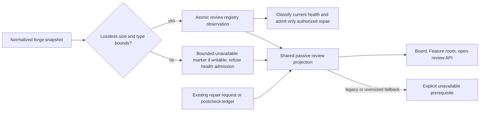

# Bound persisted review evidence and passive review responses

## Parent Epic

epic_051

## Scope

Close the confirmed scalar/payload bound gap against existing REQ-WARROOM-REVIEW-002 in cascade/war_room/DESIGN.md. This is a narrow completion of existing passive review evidence requirements, not a new general payload framework. Feature 5 retains delivery-consumer and cross-Feature recovery acceptance. Sequence afterward to reconcile shared review.py and final architecture against its integrated source.

At dcf55df7, record_feature_review_evidence caps rows but persists arbitrary-length check names and string generations; _review_evidence_projection passes generation strings through. The Architect's isolated 10,000-character reproduction is recorded in docs/epic_artifacts/epic_051_architect_feature_4_review.json.

## Required behavior and acceptance

- Define concrete serialized-size and scalar bounds for normalized persisted check evidence and its passive response projection, including aggregate/per-check generation values and check-name/status keys. Preserve ordinary supported string and integer generations, including zero. Keep the existing twenty-row presentation cap and explicit omitted/unavailable state.
- Preserve authoritative identity and equality: never make distinct check names or generations equal through truncation. Oversized or malformed authoritative evidence must remain an explicit bounded unavailable/refusal prerequisite; it cannot become empty-green, verified, fresh, or permission to admit repair. Trace actual health, admission and postcheck consumers before choosing the policy. Do not weaken exact-head/check-generation verification.
- Bound passive reads of legacy persisted observations and the repair-request/verification-postcheck fallback sources without rewriting history from GET. Board, room and open-review APIs must agree. GET/polling must perform no forge, lifecycle, repair or provider work.
- Reuse existing normalization, review registry and projection surfaces; no new store, scheduler, general CI system, dependency installation or deployment.
- Extend focused production-path persistence and API tests: boundary/over-limit input, Unicode serialized byte sizes, same-prefix distinct identities, long string and integer generation handling, omitted rows, unavailable persistence, legacy/fallback payloads and unchanged ordinary behavior. Assert bounded serialized output and unchanged authoritative comparisons. Reuse existing tests; avoid redundant exhaustive harnesses.
- Run the relevant focused review-health, postcheck and War Room checks and reconcile the final integrated acceptance record. Keep existing lifecycle/architecture fixture failures and the full Recovery-gate timeout distinct from an isolated passing retry. Epic completion remains gated on final verification and publication.

## Diagram-impact inventory and Task contract

Context/landscape (cascade-landscape, cascade-context) and cascade-containers: root/shared owners verify unchanged actors, runtime, stores and isolation because normalization stays inside current review supervision and passive UI. Components (cascade-supervisor-components, cascade-team-components, cascade-war-room-components): shared/Watchdog/War Room owners reconcile producer-to-registry-to-reader and refusal behavior. Code: cascade-watchdog-code owns record_feature_review_evidence and reconcile_open_review_health; cascade-dashboard-code owns feature_review_views and projection/read entry points. Review cascade-war-room-http-code for API behavior and cascade-feature-code/cascade-task-code for identity/fence consumers only if affected. Model/contract descriptions currently acknowledge the scalar gap and must be reconciled after the fix. Add native source-linked nodes only where significant implementation responsibilities require them.

Tasks must name owning designs, exact source symbols, view keys and update/no-change reasons across all levels. Review root DESIGN.md, cascade/DESIGN.md, cascade/watchdog/DESIGN.md and cascade/war_room/DESIGN.md plus changed interface consumers. Keep REQ-WARROOM-REVIEW-002 in its single owner. Supplementary flows must trace normal persistence/read and oversized or legacy evidence/refusal across restart, including action/postcheck fallbacks. Keep proposed policy in work records until implemented.

Validate source contracts and declaration kinds/ownership, bounded pinned rendering, actual context-to-container-to-component-to-Code Explore, Level up, deep-link restore and pinned-source opening for changed paths. Check stale/deleted symbols and warm artifact reuse without per-view process startup or relaxed bounds. Record actual checks and limits in closeout; preserve accepted snapshots. Epic Architect owns final integrated revision-pinned publication.

## Sequencing and limits

Depends on feat_051_005. Use the smallest implementation-plus-verification Task breakdown; final architecture reconciliation belongs in delivery acceptance, not a separate cleanup project. No accepted child is reopened, no Feature 5 Task is silently expanded, and no new product requirement is introduced. Escalate any necessary shared-contract expansion through the amendment protocol.

## Data structures

The canonical review registry keeps `review_health`, `required_check_policy`, `required_check_results`, `review_feedback` and `review_observed_at` on the existing Feature review row. Normalized check evidence uses exact check-name keys and exact aggregate/per-check generation values. A bounded unavailable observation carries a stable reason and no authoritative green assertion. Presentation retains at most twenty sorted check rows and an omitted count; it does not use the displayed rows as the authoritative check set. The existing Feature repair action ledger remains the fallback evidence source.

## API contracts

`record_feature_review_evidence(feature_id, snapshot, root=...) -> bool` accepts ordinary string and integer generations, including zero, losslessly. Check names and string generations are at most 256 UTF-8 bytes; integer generations are at most 64 decimal digits; the normalized observation is at most 32 KiB of serialized UTF-8 JSON. Invalid or over-limit authoritative fields return false and, when a registry write is possible, publish a bounded unavailable observation. Persistence failure also returns false. `reconcile_open_review_health` treats false as `review_evidence_persistence_failed` and does not classify the snapshot as healthy or route repair. `_review_evidence_projection` applies the same bounds to current, legacy, repair-request and verification-postcheck evidence and returns explicit unavailable status plus a safe prerequisite for malformed/over-limit data. Board, room and open-review GET use `feature_review_views`; reads do not mutate history or poll a provider or forge. Exact-head and check-generation authority stays with fresh normalization and postcheck, never with display truncation.

## Logic flow

On restart, the supervisor reads the current registry and existing action ledger. A fresh forge health pass can replace a bounded unavailable marker only after a valid normalized observation persists. Passive GET does not refresh or rewrite either source. `_review_health`, `_route_actionable_review_health` and `_required_checks` continue to compare exact heads and generations.

## Task breakdown

- `task_051_006_001` — bound normalized persistence and fail-closed health admission; no Task dependencies.
- `task_051_006_002` — bound registry and action-ledger passive projections, focused APIs, and final design/model reconciliation; depends on `task_051_006_001`.

## Risks & upward questions

A registry I/O failure cannot publish a new unavailable marker; the health worker still refuses admission and returns a typed persistence prerequisite. The passive reader must not treat an older observation as proof of current health. Model/contract files are Epic-owned: if the Task scope cannot update them through the revision-pinned workflow, route the exact source-symbol and description gap to the Epic Architect before final publication.

## Decision log

- `dec_001` · 2026-11-27 · Feature Lead · **API contracts**
  Chose Use lossless bounded review evidence: cap UTF-8 check names and string generations at 256 bytes, integer generations at 64 decimal digits, and the normalized serialized observation at 32 KiB. Reject malformed or over-limit authoritative identities; persist a small unavailable observation where the registry remains writable and return a refusal to health admission. Keep at most 20 displayed check rows with an explicit omitted count. Apply the same bounded projection to registry and repair-action fallback reads..
  Rationale: Exact name and generation equality must survive persistence and postcheck. A refusal plus a bounded unavailable marker prevents a partial or truncated observation from appearing green, while a shared projection bounds all passive surfaces and preserves ordinary values including integer zero.
  Honors: epic_051 scope and REQ-WARROOM-REVIEW-002; feat_051_006 required behavior and acceptance.

## Closeout

Completed child work: `task_051_006_001` (Bound normalized review evidence persistence), `task_051_006_002` (Bound passive review projection and reconcile architecture).
