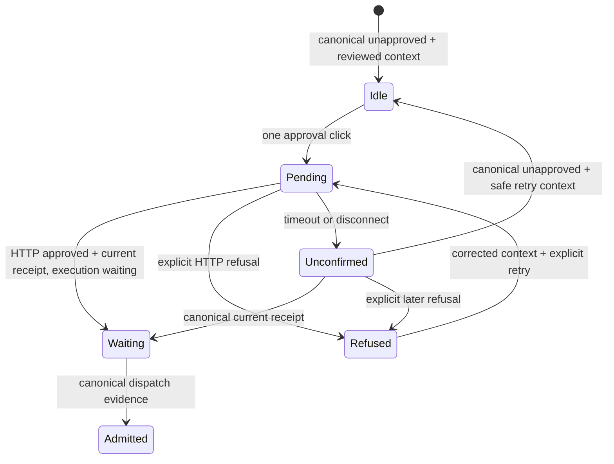

# Show Feature approval outcomes and verify deferred dispatch end to end

## Parent Epic

epic_056. Honor its explicit human approval boundary, canonical board state, review context, and automatic dependency-ordered dispatch. The predecessor feat_056_001 owns approval eligibility, persistence and response semantics; this Feature consumes them.

## Scope

Show Feature approval as an action on the War Room board and Feature plan page. Both surfaces present the exact reviewed context before submission and preserve the distinction between saved authorization and later tactical planning or execution. Display pending, saved but waiting, explicit refusal and unconfirmed transport outcomes on the affected work item without a reload.

In scope: `cascade/war_room/static/war_room.js`, `plan_viewer.js`, `epic_plan_readiness_ui.js`, `feature_readiness_ui.js`, necessary document/board serialization, focused browser/API/Git tests, War Room design and affected C4 Code views. Out of scope: a new approval authority, scheduler, ledger, attention product, broad UI redesign, deployment, and mutation of live incident Features.

## Data structures

- The canonical board's `readiness.approval` has `result`, `state`, `eligibility`, `eligible`, `explanation`, and `affected_work_ids`. The compatible execution `readiness.explanation` supplies typed reasons, links and current dispatch evidence. A current receipt can coexist with execution blockers.
- An ephemeral browser action entry is keyed by Feature ID and carries the displayed review-context identity, one in-flight request, an observed response or transport uncertainty, and a monotonic local observation token. It never grants approval and does not survive page restart.
- The plan document's `paired_review.approval_context` supplies the reviewed tuple. Any added Feature readiness field must be projected from the same canonical services as the board. Durable `approved_at` and the matching receipt remain server-owned.
- The HTTP approval result separates `approval_result` (approved/refused/unknown), `approval_state` (approved/unapproved/stale/unknown), `approval_explanation`, `affected_work_ids`, `execution_state` (waiting/admitted/completed/unknown), and `dispatch_pending`. A transport error has no authoritative result.

## API contracts

`POST /api/approve_feature` carries `id` and the exact `review_context` shown to the operator; the server rechecks that context and canonical gates. Missing/stale context is an actionable refusal and cannot approve unseen scope. The board obtains a review context through a scoped read when needed, without adding per-feature renderer work to ordinary board GET. `GET /api/board` and `GET /api/doc/{id}` reconcile action outcomes with receipt-backed canonical state. Ordinary GETs are read-only and cannot dispatch or authorize.

The control immediately disables and announces pending. One request per gesture survives rerender and out-of-order reads. A successful saved receipt is shown as approved awaiting prerequisite while `execution_state` is waiting, with typed reason and work IDs. An explicit HTTP refusal remains by the control with a corrective path or retry until superseded by newer authoritative evidence. Timeout/disconnect is unconfirmed: fetch canonical state before reporting success or allowing a duplicate action. Older polls cannot replace a confirmed newer outcome. Keep bounded write deadlines and existing Epic plan approval semantics.

## Logic flow

## Task breakdown

- `task_056_002_001` — Board review-context submission and row-local action state; depends_on: [].
- `task_056_002_002` — Feature plan-page control and preserved Epic plan approval; depends_on: [`task_056_002_001`].
- `task_056_002_003` — Real-browser/API/Git deferred-dispatch journey and design/C4 reconciliation; depends_on: [`task_056_002_001`, `task_056_002_002`].

Each Task acceptance criteria carries its own diagram impact and source symbols. The final Task reconciles the combined implementation diff and records verification evidence.

## Diagram-impact inventory

| Level / view | Owning design and source symbols | Required update and verification |
|---|---|---|
| System context `cascade-context` | Root DESIGN.md; operator, Cascade and external dependencies | Verify unchanged responsibility boundaries from final diff; update only if an external dependency or actor changes. |
| Containers `cascade-containers` | Root DESIGN.md; War Room, supervisor and repository | Verify the API/browser/receipt boundaries still agree; update if a runtime or persistence boundary changes. |
| Components `cascade-war-room-components`, `cascade-supervisor-components` | `cascade/war_room/DESIGN.md`, `cascade/DESIGN.md`; Dashboard, HTTP, approval authority | Show existing collaboration and ensure approval authority remains in the service. |
| Integrated Code `cascade-dashboard-code`, `cascade-war-room-http-code` | `cascade/war_room/DESIGN.md`; `featureApproveActionButton`, `initEpicPlanReadinessChrome`, new Feature plan control, `WarRoomRequestHandler._handle_approve_feature`, `WarRoomRequestHandler._handle_doc` as changed | Reconcile model.dsl, views.dsl and workspace.contract.json with real declarations and source links; validate Explore→Code, Level up and deep-link restoration. |
| Supplementary action flow | `cascade/war_room/DESIGN.md` | Explain pending, receipt-backed wait, refusal, transport uncertainty, persistence and restart in a focused flow diagram. |

## Verification

Use production loopback HTTP with isolated real Git and Chromium. In fixture identities, approve dependent feat_051_006 once while feat_051_005 remains active; refresh and restart, verify persisted current approval and zero premature Feature/Task start events or leases; complete and verify its predecessor, then prove exactly one canonical dispatch without a second click. Retain sibling, integration and review blockers until independently cleared. Browser/API cases cover late-minted approved and unapproved children, delayed and repeated input/polls, refusal IDs, stale reviewed scope, provider/architecture/software refusal, transport uncertainty and accessible feedback. Run focused architecture validation, rendering, source-link and navigation checks, including renamed/deleted symbols, ownership mismatch and measured warm reuse.

## Risks & upward questions

The board does not currently carry a review context. Retrieve the scoped context when the operator engages the action and present it before POST; keep routine board reads bounded. If a required model edit is outside Task ownership, route that exact gap to the owning architecture team before closeout.

## Planning design review

Reviewed `DESIGN.md`, `cascade/DESIGN.md`, `cascade/war_room/DESIGN.md`, and the pinned `model.dsl`, `views.dsl`, `workspace.contract.json` source for the existing approval path. No repository design file changed in this planning turn; the model already has the Dashboard and HTTP Code views and links the current `featureApproveActionButton`, `initEpicPlanReadinessChrome`, and `WarRoomRequestHandler._handle_approve_feature` declarations. The implementation tasks own reconciliation of changed symbols and the final design review. Source-contract validation, rendering, interactive navigation and measured warm reuse remain acceptance checks for task_056_002_003; they are not yet verified.

## Decision log

- `dec_001` · 2026-11-27 · Feature Lead · **API contracts**
  Chose Both approval controls submit the exact displayed review_context; the board retrieves a scoped context on demand and ordinary board GET remains a bounded read projection..
  Rationale: The approval authority already validates reviewed scope. Presenting and sending the same tuple prevents unseen-scope approval without adding per-feature review rendering to polling.
  Honors: epic_056 human approval and bounded War Room read boundaries; REQ-CASCADE-APPROVAL-001..

- `dec_002` · 2026-11-27 · Feature Lead · **Logic flow**
  Chose Use a transient per-Feature browser action state for pending, refusal and unconfirmed transport; only canonical receipt-backed GET evidence confirms durable approval or execution..
  Rationale: Row rerenders and delayed responses cannot duplicate a POST or invent approval. Restart reconstruction remains tied to the server-owned timestamp and receipt.
  Honors: epic_056 canonical board and dispatch boundaries; REQ-CASCADE-APPROVAL-001..

## Closeout

Completed child work: `task_056_002_001` (Show durable Feature approval outcomes on War Room board), `task_056_002_002` (Add Feature approval control to plan page with reviewed context), `task_056_002_003` (Prove deferred Feature dispatch in browser and reconcile War Room design).
